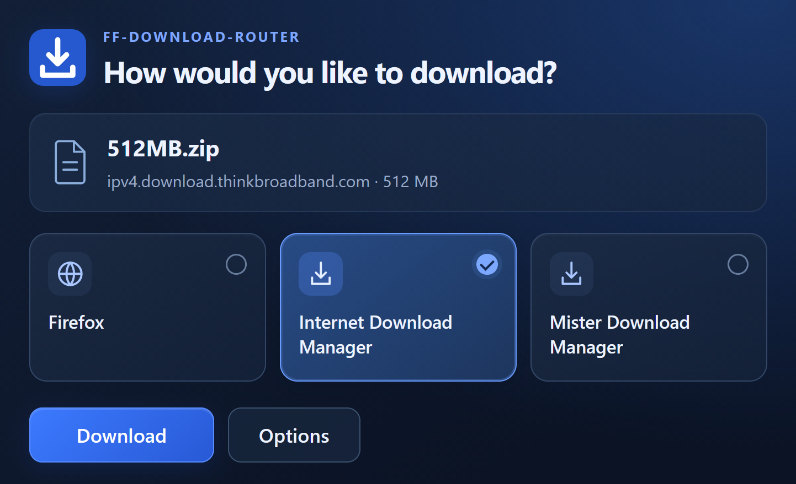

# Firefox Download Router

Choose Firefox, Internet Download Manager, Mister Download Manager, or another Windows download manager before downloading a file. Your preferred downloader is selected automatically.

**Requirements:** Windows 10/11 x64 and Firefox 142 or later.

## Download and install

Download **FF-Download-Router-0.4.0-Windows-x64.zip** from the [latest release](https://github.com/LordSpectre/Firefox-Download-Router/releases/latest) and extract the complete archive.

1. Run **Install-component.cmd** to install the local Windows component. Administrator rights and a separate .NET installation are not required.
2. In Firefox, open `about:addons`, click the gear icon, and choose **Install Add-on From File…**. Select **FF-Download-Router-0.4.0.xpi** and confirm the installation.
3. Open the extension's **Options**. Use **Browse…** to select each download manager's executable, choose your **Preferred downloader**, and click **Save settings**.

The extension starts in English. Choose **Language** in Options to switch immediately between 20 languages and regional variants.

## Use

When a download is detected, select a downloader and click **Download**. To use Firefox's built-in downloader, select **Firefox** and click **Download**. Closing the chooser with **X** cancels the pending download.

Add programs in Options and select an argument profile: **IDM / Mister**, **URL only**, or **Custom arguments**. Disable competing automatic download capture integrations in Firefox so the router can handle the request.

For downloads that require your browser session, choose Firefox. POST downloads use Firefox to preserve the original request. The toolbar button lets you pause or enable the chooser.

## Uninstall

Remove the extension from `about:addons` and run **Uninstall-component.cmd** to remove the Windows component. The component's saved configuration is retained.
